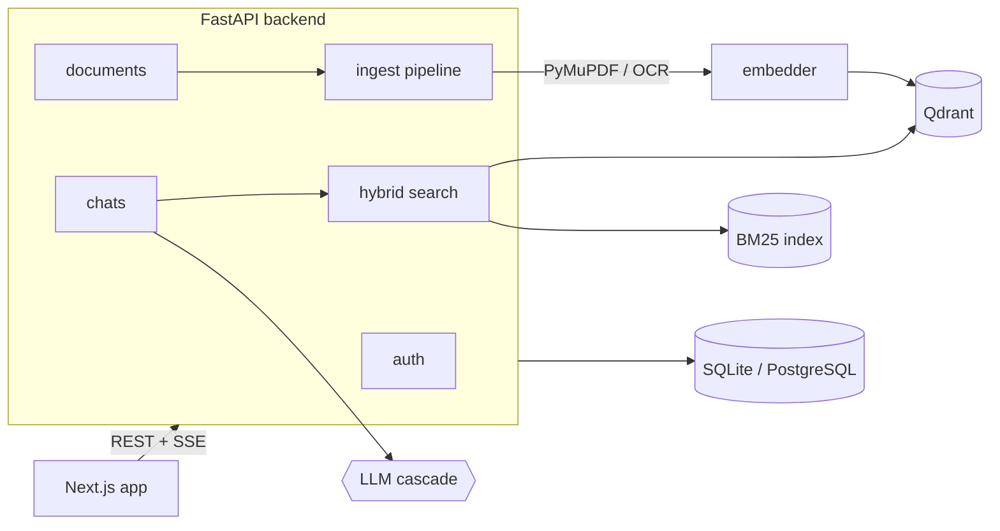

<div align="center">


# DocSage

**Chat with your documents. Get answers you can verify.**

A full-stack RAG app: upload PDFs or scanned images, ask questions in plain language, and get streamed answers that cite the exact file and page they came from.


</div>

---

## Why DocSage

LLMs hallucinate. DocSage constrains them to **your** documents and shows its work: every answer lists the source file, page number and an excerpt, so you can check it in seconds.

- **Hybrid retrieval**: semantic vector search (Qdrant) plus BM25 keyword search, fused with Reciprocal Rank Fusion.
- **Resilient LLM layer**: Groq → Cerebras → OpenRouter, with per-provider cooldowns so one rate limit doesn't break chat.
- **Scanned documents**: Tesseract OCR, with an OpenRouter vision-model fallback.
- **Streaming UX**: answers arrive token by token over Server-Sent Events.
- **Private by default**: JWT auth, bcrypt hashing, every query scoped to the signed-in user.

## Features

| | |
|---|---|
| **Upload** | PDFs and images (`.png`, `.jpg`, `.jpeg`, `.webp`), 20 MB by default, content-checked |
| **Processing** | PyMuPDF text extraction, OCR for scanned pages, ~900-character chunks with 150-character overlap |
| **Search** | `BAAI/bge-small-en-v1.5` embeddings (384-d) + BM25, merged with RRF |
| **Chat** | Streaming answers, saved history, one chat per topic |
| **Citations** | File, page and excerpt for every answer |
| **Inspector** | Expand any document to see the chunks that were extracted from it |
| **Share** | Copy or share an answer together with its citations |
| **Auth** | Register, sign in, email confirmation, password reset and change, account deletion, session rotation with theft detection |
| **Site** | Home, Features, How it works, Security, Contact, plus Terms, Privacy and Cookie pages |
| **UI** | Responsive, light and dark theme following your system, reduced-motion aware |

## Architecture



```
INGEST   Upload ─► extract text (PyMuPDF, OCR for scans) ─► chunk ─► embed ─► Qdrant + SQL

QUERY    Question ─► vector search ┐
                                   ├─► RRF merge ─► top-K chunks ─► prompt ─► LLM ─► streamed answer + citations
         BM25 keyword search      ┘
```

**LLM cascade.** Providers are tried in `LLM_PROVIDER_ORDER`. A provider that fails is skipped for 60 seconds. Failover only happens before the first token: if a stream dies mid-answer, the error is surfaced rather than splicing in another model's text.

**Streaming protocol.** `POST /api/chats/{id}/ask` returns `text/event-stream` with `sources`, `token`, `done` and `error` events.

## Tech stack

| Layer | Technologies |
|---|---|
| Frontend | Next.js 16 (App Router), React 19, TypeScript, Tailwind CSS 4, react-markdown |
| Backend | FastAPI, Python 3.11+, Pydantic v2, async SQLAlchemy 2 |
| LLMs | Groq, Cerebras, OpenRouter (all OpenAI-compatible) |
| Embeddings | `fastembed` (ONNX, no PyTorch) · `BAAI/bge-small-en-v1.5` |
| Vector DB | Qdrant (in-memory by default, or a Docker server) |
| Keyword search | `rank-bm25` |
| Documents / OCR | PyMuPDF, Tesseract (`pytesseract`), Pillow |
| Database | SQLite (default) or PostgreSQL |

## Quick start

**Prerequisites:** Python 3.11+, Node.js 20+, and one LLM key ([Groq](https://console.groq.com/) has a free tier). Optional: [Tesseract](https://github.com/tesseract-ocr/tesseract) for OCR, Docker for a persistent Qdrant.

### 1. Backend

```bash
cd backend
python -m venv .venv
source .venv/bin/activate            # Windows: .\.venv\Scripts\Activate.ps1
pip install -r requirements.txt

cp .env.example .env                 # set SECRET_KEY and at least one LLM key
uvicorn docsage.main:app --reload --port 8000
```

Tables are created on startup. Swagger UI: <http://localhost:8000/docs> · Health: <http://localhost:8000/health>

The first start downloads the embedding model (about 130 MB). Check your LLM keys with `python -m docsage.check_llm` and the running server at <http://localhost:8000/health/ready>.

### 2. Frontend

```bash
cd frontend
cp .env.example .env.local           # NEXT_PUBLIC_API_URL, defaults to http://localhost:8000
npm install
npm run dev
```

Open <http://localhost:3000>, create an account, upload a PDF, then open **Chat**.

### 3. Persistent vector store (optional)

```bash
docker compose up -d                 # Qdrant on :6333
# in backend/.env:  QDRANT_MODE=http
```

With the default `QDRANT_MODE=memory`, vectors live in RAM and the backend re-embeds stored chunks on every start.

## API

All routes live under `/api` and need a Bearer token except the public auth routes.

| Area | Endpoints |
|---|---|
| **Auth** | `POST /auth/register` · `login` · `refresh` · `logout` · `GET /auth/me` · `DELETE /auth/me` |
| **Account** | `POST /auth/verify-email` · `resend-verification` · `forgot-password` · `reset-password` · `change-password` |
| **Documents** | `POST /documents` · `GET /documents` · `GET /documents/{id}` · `GET /documents/{id}/chunks` · `DELETE /documents/{id}` |
| **Chats** | `GET/POST /chats` · `DELETE /chats/{id}` · `GET /chats/{id}/messages` · `POST /chats/{id}/ask` (SSE) |

## Configuration

Set in `backend/.env`; see [.env.example](backend/.env.example).

| Variable | Default | Purpose |
|---|---|---|
| `DATABASE_URL` | SQLite file | SQLite or `postgresql+asyncpg://…` (then `pip install asyncpg`) |
| `SECRET_KEY` | dev placeholder | JWT signing key. **Set your own.** |
| `GROQ_API_KEY` / `CEREBRAS_API_KEY` / `OPENROUTER_API_KEY` | empty | Any one is enough |
| `LLM_PROVIDER_ORDER` | `groq,cerebras,openrouter` | Fallback order |
| `OPENROUTER_VISION_MODELS` | 3 free models | Image OCR when Tesseract is absent |
| `QDRANT_MODE` | `memory` | `memory` or `http` (`QDRANT_URL`) |
| `ENVIRONMENT` | `development` | `production` refuses to start with a weak `SECRET_KEY` |
| `FRONTEND_URL` / `CORS_ORIGIN_REGEX` | `http://localhost:3000` / empty | Allowed browser origins (comma separated) / regex for Vercel previews |
| `QDRANT_API_KEY` | empty | For Qdrant Cloud |
| `EMBEDDING_MODEL` | `BAAI/bge-small-en-v1.5` | Any model supported by fastembed |
| `OCR_LANGUAGES` / `TESSERACT_CMD` | `eng` / auto | Tesseract languages / binary path if not on PATH |
| `AUTH_RATE_PER_MINUTE` / `ASK_RATE_PER_MINUTE` | `20` / `30` | Rate limits |
| `TOP_K` / `MIN_SCORE` / `MAX_CONTEXT_CHARS` | `5` / `0.25` / `12000` | Retrieval tuning |
| `OCR_ENABLED` / `OCR_MAX_PAGES` | `true` / `25` | OCR switch and per-document page cap |
| `MAX_UPLOAD_MB` | `20` | Upload limit |
| `BFF_SECRET` | empty | Shared with the frontend so the real visitor IP is rate limited |
| `RESEND_API_KEY` or `SMTP_*`, `EMAIL_FROM` | empty | Confirmation and reset emails (logged only when unset) |
| `REQUIRE_EMAIL_VERIFICATION` | `false` | Require a confirmed email before uploading or asking |
| `REDIS_URL` | empty | Share rate limits across instances (optional) |
| `MAX_DOCUMENTS_PER_USER` / `MAX_STORAGE_MB_PER_USER` / `MAX_PDF_PAGES` | `50` / `200` / `300` | Per-user quotas |
| `SENTRY_DSN` | empty | Optional error reporting, no personal data |

> **Privacy note:** without Tesseract, images and scanned PDF pages are sent to a third-party OpenRouter vision model for OCR.
>
> **Sign-in design:** the browser holds a 15-minute access token in memory only. The long-lived refresh token is an HttpOnly cookie set by the Next.js server (`/api/session/*`) on the site's own domain, rotated on every use, and revoking all sessions if an old one is replayed.

## Deploy

Frontend on **Vercel**, backend on **Render** or **Railway**. The backend ships as a Docker image that already contains Tesseract and the embedding model.

### 1. Backend

**Render:** *New > Blueprint*, select this repo. [render.yaml](render.yaml) creates the API and a Postgres database. Fill in `FRONTEND_URL` and your LLM keys when asked.

**Railway:** *New Project > Deploy from GitHub*, set the service **Root Directory** to `backend` (it picks up [railway.json](backend/railway.json)), add a PostgreSQL plugin, then set:

```
ENVIRONMENT=production
SECRET_KEY=<python -c "import secrets; print(secrets.token_urlsafe(48))">
DATABASE_URL=${{Postgres.DATABASE_URL}}
FRONTEND_URL=https://<your-app>.vercel.app
GROQ_API_KEY=...   CEREBRAS_API_KEY=...   OPENROUTER_API_KEY=...
```

Check it: `https://<backend>/health/ready` should list your LLM providers and `"ocr": "tesseract"`.

### 2. Frontend (Vercel)

Import the repo, set **Root Directory** to `frontend`, and add:

```
NEXT_PUBLIC_API_URL=https://<backend>      # no trailing slash, read at build time
BFF_SECRET=<same value as on the backend>
NEXT_PUBLIC_LEGAL_NAME=<who operates the service>
NEXT_PUBLIC_CONTACT_EMAIL=<your support address>
NEXT_PUBLIC_JURISDICTION=<e.g. England and Wales>
```

Redeploy after changing them, then put the Vercel URL in the backend's `FRONTEND_URL`. Also set `BFF_SECRET` and, for emails, `RESEND_API_KEY` and `EMAIL_FROM` on the backend.

**Before launch:** have a lawyer review the Terms, Privacy and Cookie pages (`frontend/app/(site)/`), which describe the app as built but are not legal advice.

### Production notes

- **Run one worker.** The keyword index, rate limiter and in-memory vector store are per process (the Dockerfile does this).
- **Vectors.** With `QDRANT_MODE=memory` the index is rebuilt after every restart. For a persistent index create a free [Qdrant Cloud](https://cloud.qdrant.io/) cluster and set `QDRANT_MODE=http`, `QDRANT_URL`, `QDRANT_API_KEY`.
- **Free tiers sleep.** The first request after idle can take 30-60 s while the API wakes; the app keeps you signed in meanwhile. Render's free Postgres expires after 30 days; use a paid plan or Neon/Supabase for anything lasting.
- **Memory.** The embedding model needs roughly 300-400 MB, so use a plan with at least 512 MB.
- **Uploads** are deleted as soon as their text is extracted and indexed. Your searchable data lives in the database and vector store.

## Project structure

```
DocSage/
├── render.yaml  docker-compose.yml  SECURITY.md  .github/   # deploy blueprint, CI, Dependabot
├── backend/
│   ├── Dockerfile  alembic.ini  railway.json  migrations/
│   ├── docsage/
│   │   ├── main.py  config.py  db.py  models.py  schemas.py  security.py  deps.py
│   │   ├── middleware.py  ratelimit.py  check_llm.py
│   │   ├── routers/            # auth, documents, chats
│   │   └── services/           # chunking, extract, ocr, embeddings, vectorstore, search,
│   │                           # llm (cascade), prompt, ingest, sessions, mailer
│   └── tests/
└── frontend/
    ├── app/
    │   ├── (site)/             # home, features, how-it-works, security, contact, terms, privacy, cookies
    │   ├── (auth)/             # login, register, forgot/reset password, verify email
    │   ├── (app)/              # documents, chat, settings
    │   └── api/session/        # sign-in proxy holding the HttpOnly refresh cookie
    ├── components/             # site, home, demo (animated chat), chat, auth
    └── lib/                    # api client + SSE reader, auth context, site content
```

## Development

```bash
cd backend && pip install -r requirements-dev.txt && pytest
cd frontend && npm run typecheck && npm run build
```

The backend tests cover chunking, rank fusion, the LLM failover rules, auth, isolation, chat, OCR (when Tesseract is installed), SQLite locking, rate limits and config. They run without any API key or model download.

## License

MIT © 2026 Soujanya-20-create
