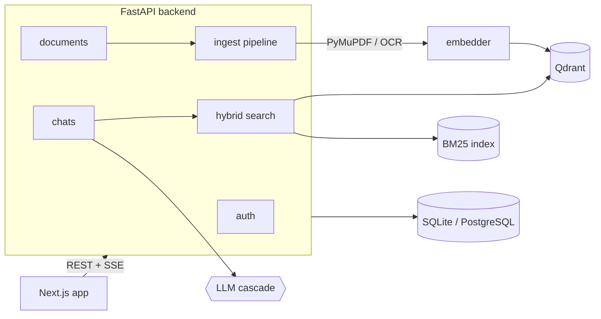

<div align="center">


# DocSage

**Chat with your documents. Get answers you can verify.**

A full-stack RAG app: upload PDFs or scanned images, ask questions in plain language, and get streamed answers that cite the exact file and page they came from.


</div>

---

## Why DocSage

LLMs hallucinate. DocSage constrains them to **your** documents and shows its work: every answer lists the source file, page number and an excerpt, so you can check it in seconds.

- **Hybrid retrieval**: semantic vector search (Qdrant) plus BM25 keyword search, fused with Reciprocal Rank Fusion.
- **Resilient LLM layer**: Groq → Cerebras → OpenRouter, with per-provider cooldowns so one rate limit doesn't break chat.
- **Scanned documents**: Tesseract OCR, with an OpenRouter vision-model fallback.
- **Streaming UX**: answers arrive token by token over Server-Sent Events.
- **Private by default**: JWT auth, bcrypt hashing, every query scoped to the signed-in user.

## Features

| | |
|---|---|
| **Upload** | PDFs and images (`.png`, `.jpg`, `.jpeg`, `.webp`), 20 MB by default, content-checked |
| **Processing** | PyMuPDF text extraction, OCR for scanned pages, ~900-character chunks with 150-character overlap |
| **Search** | `BAAI/bge-small-en-v1.5` embeddings (384-d) + BM25, merged with RRF |
| **Chat** | Streaming answers, saved history, one chat per topic |
| **Citations** | File, page and excerpt for every answer |
| **Inspector** | Expand any document to see the chunks that were extracted from it |
| **Auth** | Register, login and silent token refresh |
| **UI** | Responsive layout, light and dark theme following your system |

## Architecture



```
INGEST   Upload ─► extract text (PyMuPDF, OCR for scans) ─► chunk ─► embed ─► Qdrant + SQL

QUERY    Question ─► vector search ┐
                                   ├─► RRF merge ─► top-K chunks ─► prompt ─► LLM ─► streamed answer + citations
         BM25 keyword search      ┘
```

**LLM cascade.** Providers are tried in `LLM_PROVIDER_ORDER`. A provider that fails is skipped for 60 seconds. Failover only happens before the first token: if a stream dies mid-answer, the error is surfaced rather than splicing in another model's text.

**Streaming protocol.** `POST /api/chats/{id}/ask` returns `text/event-stream` with `sources`, `token`, `done` and `error` events.

## Tech stack

| Layer | Technologies |
|---|---|
| Frontend | Next.js 16 (App Router), React 19, TypeScript, Tailwind CSS 4, react-markdown |
| Backend | FastAPI, Python 3.11+, Pydantic v2, async SQLAlchemy 2 |
| LLMs | Groq, Cerebras, OpenRouter (all OpenAI-compatible) |
| Embeddings | `sentence-transformers` · `BAAI/bge-small-en-v1.5` |
| Vector DB | Qdrant (in-memory by default, or a Docker server) |
| Keyword search | `rank-bm25` |
| Documents / OCR | PyMuPDF, Tesseract (`pytesseract`), Pillow |
| Database | SQLite (default) or PostgreSQL |

## Quick start

**Prerequisites:** Python 3.11+, Node.js 20+, and one LLM key ([Groq](https://console.groq.com/) has a free tier). Optional: [Tesseract](https://github.com/tesseract-ocr/tesseract) for OCR, Docker for a persistent Qdrant.

### 1. Backend

```bash
cd backend
python -m venv .venv
source .venv/bin/activate            # Windows: .\.venv\Scripts\Activate.ps1
pip install -r requirements.txt

cp .env.example .env                 # set SECRET_KEY and at least one LLM key
uvicorn docsage.main:app --reload --port 8000
```

Tables are created on startup. Swagger UI: <http://localhost:8000/docs> · Health: <http://localhost:8000/health>

The first start downloads the embedding model (about 130 MB).

### 2. Frontend

```bash
cd frontend
cp .env.example .env.local           # NEXT_PUBLIC_API_URL, defaults to http://localhost:8000
npm install
npm run dev
```

Open <http://localhost:3000>, create an account, upload a PDF, then open **Chat**.

### 3. Persistent vector store (optional)

```bash
docker compose up -d                 # Qdrant on :6333
# in backend/.env:  QDRANT_MODE=http
```

With the default `QDRANT_MODE=memory`, vectors live in RAM and the backend re-embeds stored chunks on every start.

## API

All routes live under `/api` and need a Bearer token except register, login and refresh.

| Area | Endpoints |
|---|---|
| **Auth** | `POST /auth/register` · `POST /auth/login` · `POST /auth/refresh` · `GET /auth/me` |
| **Documents** | `POST /documents` · `GET /documents` · `GET /documents/{id}` · `GET /documents/{id}/chunks` · `DELETE /documents/{id}` |
| **Chats** | `GET/POST /chats` · `DELETE /chats/{id}` · `GET /chats/{id}/messages` · `POST /chats/{id}/ask` (SSE) |

## Configuration

Set in `backend/.env`; see [.env.example](backend/.env.example).

| Variable | Default | Purpose |
|---|---|---|
| `DATABASE_URL` | SQLite file | SQLite or `postgresql+asyncpg://…` (then `pip install asyncpg`) |
| `SECRET_KEY` | dev placeholder | JWT signing key. **Set your own.** |
| `GROQ_API_KEY` / `CEREBRAS_API_KEY` / `OPENROUTER_API_KEY` | empty | Any one is enough |
| `LLM_PROVIDER_ORDER` | `groq,cerebras,openrouter` | Fallback order |
| `OPENROUTER_VISION_MODELS` | 3 free models | Image OCR when Tesseract is absent |
| `QDRANT_MODE` | `memory` | `memory` or `http` (`QDRANT_URL`) |
| `EMBEDDING_MODEL` | `BAAI/bge-small-en-v1.5` | Any sentence-transformers model |
| `TOP_K` / `MIN_SCORE` / `MAX_CONTEXT_CHARS` | `5` / `0.25` / `12000` | Retrieval tuning |
| `OCR_ENABLED` / `OCR_MAX_PAGES` | `true` / `25` | OCR switch and per-document page cap |
| `MAX_UPLOAD_MB` | `20` | Upload limit |

> **Privacy note:** without Tesseract, images and scanned PDF pages are sent to a third-party OpenRouter vision model for OCR.
>
> **Auth note:** tokens are kept in `localStorage`, which is simple but readable by any script on the page. For a hardened deployment, move them to httpOnly cookies.

## Project structure

```
DocSage/
├── docker-compose.yml
├── backend/
│   ├── docsage/
│   │   ├── main.py  config.py  db.py  models.py  schemas.py  security.py  deps.py
│   │   ├── routers/            # auth, documents, chats
│   │   └── services/           # chunking, extract, ocr, embeddings, vectorstore,
│   │                           # search (hybrid + RRF), llm (cascade), prompt, ingest
│   └── tests/
└── frontend/
    ├── app/                    # landing, login, register, (app)/documents, (app)/chat
    ├── components/             # AuthForm
    └── lib/                    # api client + SSE reader, auth context
```

## Development

```bash
cd backend && pip install -r requirements-dev.txt && pytest
cd frontend && npm run typecheck && npm run build
```

The backend tests cover chunking, rank fusion, the LLM failover rules and the auth, isolation and chat endpoints. They run without any API key or model download.

## License

MIT © 2026 Soujanya-20-create
